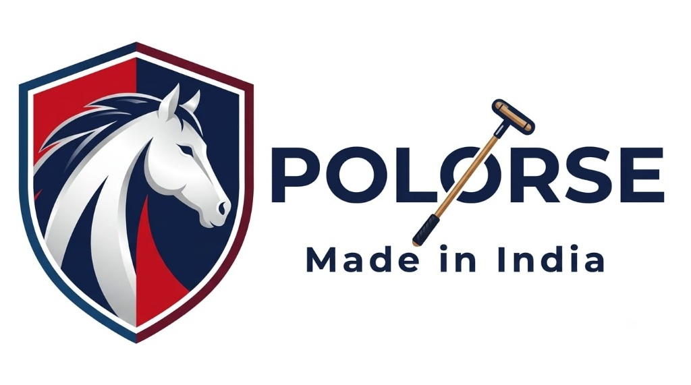

# POLORSE • Luxury Heavyweight Streetwear & Apparel

<div align="center">
  
  <h3>High-Density French Terry • Made in India • Equestrian Heritage</h3>
  <p>Modern Direct-to-Consumer (D2C) E-Commerce Platform with Storefront, Backoffice Admin Portal, and Delivery Logistics Engine.</p>
</div>

---

## 🌟 Key Features

### 🛍️ Customer Storefront
- **Luxury Aesthetic**: Curated Creme & White mixture (`#FAF7F2` warm ivory + `#FFFFFF` crisp white + `#0F1C3F` Polorse Navy + `#C21A2C` Heritage Crimson).
- **Rich Apparel Drops**: Comprehensive catalog across **Hoodies, T-Shirts, Shirts, Jeans, Cargo Pants, and Chinos** with fabric weights (420 GSM french terry, 14 oz selvedge denim, 100% European linen).
- **Garment Customization**: Real-time size selection (`S` to `XXL` / `30` to `36`), live stock counter, and color swatches.
- **Pincode Deliverability & Auto-Detect**: 
  - Instant 6-digit Indian PIN code checker.
  - One-click HTML5 Geolocation with reverse geocoding to auto-fill location.
  - Courier SLA transit estimates and Cash on Delivery (COD) indicator.
- **Shopping Bag & Discounts**: Slide-out cart drawer with free shipping progress bar and promotional coupon codes (`POLORSE500`, `FIRSTDROP`).
- **Checkout & Instant Order Placement**: Seamless checkout supporting Cash on Delivery (COD) and UPI payments with celebratory confetti animation.

### 👔 Brother's Admin Portal
- **Business Overview**: Real-time gross revenue metrics, total orders placed, live catalog counters, and active discount vouchers.
- **Apparel Uploader**: Upload clothes with multi-size stock inventory, color swatches, MRP vs selling price, discount badge calculator, and photo file upload.
- **Order Logistics & WhatsApp Action**: View customer shipping details, update statuses (`Confirmed` ➔ `Processing` ➔ `Shipped` ➔ `Delivered`), and directly message customers on WhatsApp with a single click.
- **Coupon Manager**: Create percentage-based or flat rupee promotional coupons with minimum order rules.
- **Delivery & Pincodes Diagnostic Tool**: Test any Indian PIN code for serviceability, manage 1–2 Day Express Metro hubs, block non-serviceable PINs, and adjust delivery SLAs.
- **Cloud Database Ready**: Built to sync seamlessly with Google Cloud Firestore or run in zero-config offline mode.

---

## 📱 Future Mobile App (Flutter / iOS) Ready
Designed with an API-first Firestore schema so your Flutter mobile app can connect directly to the same database:
- `products`: Apparel catalog with sizes, colors, tags, and stock.
- `orders`: Customer details, shipping addresses, ordered items, and payment status.
- `coupons`: Active discount vouchers.

---

## 🚀 Getting Started

### Prerequisites
- Node.js (v18 or higher)
- npm

### Installation
```bash
# Clone the repository
git clone https://github.com/Fatehp/polorse-apparel-store.git

# Navigate to project folder
cd polorse-apparel-store

# Install dependencies
npm install

# Start development server
npm run dev
```

Visit `http://localhost:5173/` in your browser.

---

## 🛠️ Tech Stack
- **Frontend**: React 19, Vite
- **Styling**: Vanilla CSS Design Tokens (Creme & White luxury palette, responsive grid)
- **Icons**: Lucide React
- **Logistics**: India Post PIN API & OpenStreetMap Geocoding
- **State & Storage**: Cloud Firestore SDK + LocalStorage fallback
- **Animations**: Canvas Confetti & micro-interactions

---

## 📄 License
Private & Proprietary • Polorse India
